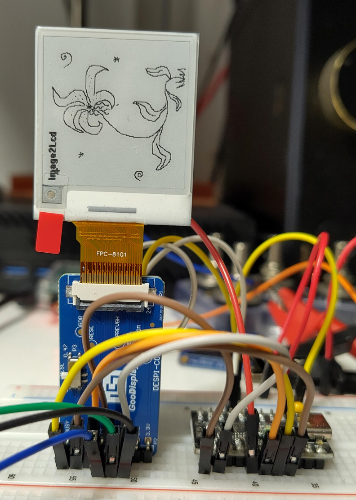

# SPI SSD1681 Example

Simple example based on 1.54 inch GDEM0154D67WT e-paper display.

## Sources

- Majority of SPI-related code, helper functions etc. were inspired or outright copied from [../../extralibs/ch32v003_SPI.h](https://github.com/cnlohr/ch32fun/blob/b28d285460ce052a179dba8f4a22c6f73ff8e328/extralibs/ssd1306_spi.h). Example "inlines" it, to make it easier to follow and understand.
- SSD1681-related code is adaptation of display producer-provided examples (can be found [here](https://www.good-display.com/product/556.html); no ch32v003 support though, hence this example).
- [SSD1681 docs](https://v4.cecdn.yun300.cn/100001_1909185148/GDEM0154D67WTnew.pdf) (especially "Command Table").

